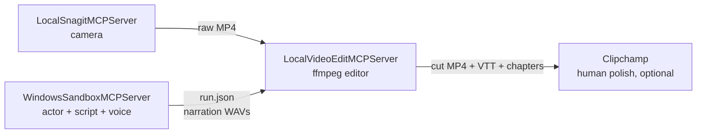

# Plan: Post-production (Phases 7–9)

Companion to [PLAN.md](PLAN.md), which covers Phases 0–6.
Editor repo plan: `LocalVideoEditMCPServer/PLAN.md`.

Phases 0–6 produce a *take*: a raw recording of a real run on a clean machine. This plan turns a take
into a *video*. It adds a third repo — `LocalVideoEditMCPServer` — and gives this one two new jobs:
**speaking the narration** and **describing what happened**.

---

## 1. Why the take and the video are different things

A real `azd up` on a clean machine runs for the better part of an hour. Maybe eight minutes of that
is content; the rest is progress bars. Both matter, for different reasons:

- The **raw take** is the evidence. It proves the thing really installed from nothing, unedited.
- The **cut** is the story. Nobody watches a bicep deployment in real time.

So: record everything, cut in post, and never fake a result. Three servers, one story.



**Clipchamp is not automatable and we are not going to try.** Its only public API repos
(`clipchamp-button-examples`, `clipchamp-wordpress`, `clipchamp-gdrive-proxy`) are for the retired
pre-Microsoft "button API" and were archived in 2020. The current product has no REST API, no SDK,
no plugin model and no documented project format. Automating it would mean driving a signed-in web
UI, which is brittle, untestable and on the wrong side of its terms. Clipchamp stays a *human* step:
it imports the finished MP4, the narration WAV and the VTT as assets when a take needs hand polish.

**The key realisation:** dead air is not a video-analysis problem. `storyboard.run()` already stamps
`at_seconds` and `seconds` on every step, `save_transcript` already stamps `wall_start`/`wall_end` on
every cue, and the guest log already knows when an installer actually finished. A step that ran
eleven minutes with one twelve-second line of narration is 10:48 of dead air, and we know that
without inspecting a single pixel. Pixel analysis becomes a *safety check* that stops us cutting
through a scrolling log — never the primary signal.

---

## 2. Narration with Azure Speech (Phase 7)

The words already live in the storyboards as `say:` / `say_after:`. This phase gives them a voice.

### Configuration

Extend `Settings.from_env()`:

| Var | Default | Purpose |
|---|---|---|
| `AZURE_SPEECH_RESOURCE_ID` | — | Speech resource ARM id; selects Entra auth |
| `AZURE_SPEECH_REGION` | — | e.g. `eastus` |
| `AZURE_SPEECH_ENDPOINT` | — | optional override / private endpoint |
| `AZURE_SPEECH_KEY` | — | fallback only; Entra is the default path |
| `AZURE_SPEECH_VOICE` | `en-US-ChristopherNeural` | default narrator |
| `AZURE_SPEECH_STYLE` | — | optional `mstts:express-as` style |
| `AZURE_SPEECH_RATE` | — | baseline `<prosody rate>` |
| `AZURE_SPEECH_FORMAT` | `riff-24khz-16bit-mono-pcm` | PCM in, encode once at the end |
| `AZURE_SPEECH_CACHE_DIR` | `<work_dir>/narration` | content-addressed cue cache |

**Auth is Entra ID, not a key.** `DefaultAzureCredential` → token for
`https://cognitiveservices.azure.com/.default`, then the Speech SDK's authorization-token form:

```python
token = credential.get_token("https://cognitiveservices.azure.com/.default").token
speech_config = SpeechConfig(
    auth_token=f"aad#{settings.speech_resource_id}#{token}",
    region=settings.speech_region,
)
```

Two gotchas that will cost an afternoon otherwise: the Speech resource **must have a custom
subdomain** for Entra auth to work at all (a plain regional endpoint only accepts keys), and the
caller needs the **Cognitive Services Speech User** role. Tokens expire in ~10 minutes, so refresh
per synthesis batch rather than caching a `SpeechConfig`.

### Why `en-US-ChristopherNeural` and not an HD voice

This is a capability decision, not a taste one. DragonHD and Dragon HD Omni voices **do not support
`<prosody>`, `<bookmark>` or `mstts:audioduration`**. Of those, `mstts:audioduration` is the one that
matters most here — it tells the service to land a line at an exact duration and adjusts rate to hit
it, which is the mechanism for refitting narration to an edited slot. `<bookmark>` gives exact
per-cue audio offsets. Both are standard-neural only.

`en-US-Christopher:DragonHDOmniLatestNeural` exists and is worth an A/B on takes where nothing needs
refitting, so `AZURE_SPEECH_VOICE` must accept it — but the default stays standard neural.

### New module: `src/sandbox_mcp/speech.py`

Optional dependency, so the server still imports and runs without it:

```toml
[project.optional-dependencies]
speech = ["azure-cognitiveservices-speech>=1.40", "azure-identity>=1.17"]
```

`check_sandbox_setup` gains a `narration` block reporting whether the extra is installed, whether
credentials resolve, and which voice is configured — same spirit as the existing capability probe.

### New tools

| Tool | Purpose |
|---|---|
| `list_voices(locale, gender, hd, refresh)` | The voice gallery. Hits the service's own voice list, caches to disk, filters. Returns name, display name, gender, styles, and whether the voice supports `mstts:audioduration`. |
| `synthesize_narration(storyboard, voice, target_durations, out_dir)` | Synthesizes every cue. With no `target_durations` this is the **pre-flight** pass. With them, it is the **refit** pass. |
| `export_timeline(...)` | Section 3. |

### Caching

Key on `sha256(voice + style + rate + target_duration + text)`. Re-running a storyboard after editing
one line re-synthesizes one line. This matters for iteration speed far more than for cost.

### `narration.json`

```json
{
  "schema": "sandbox-narration/1",
  "voice": "en-US-ChristopherNeural",
  "cues": [
    {
      "id": "s12-say", "step": 12, "kind": "say",
      "text": "First the application name, which becomes the stem of every resource name.",
      "audio": "cues/s12-say.wav", "duration": 5.34,
      "words": [{ "text": "First", "offset": 0.11 }, { "text": "the", "offset": 0.42 }]
    }
  ]
}
```

`duration` comes from the synthesis result, not an estimate. `words` comes from
`synthesis_word_boundary`, which is what makes word-accurate captions possible instead of the
current one-cue-per-step blocks.

### Feed the measured durations back

[`transcript.cue_duration`](src/sandbox_mcp/transcript.py) currently guesses at 2.6 words/second.
Give it an optional lookup into `narration.json` and fall back to the guess when narration has not
been synthesized. This improves the existing `.vtt`/`.srt`/`.md` output immediately, before any video
work exists — which makes Phase 7 worth shipping on its own.

### Post-production, not live

Do not play narration during the take. Recording system audio would also capture guest audio and host
notifications, it couples re-recording the voice to re-recording the video, and it puts an audio
device in the critical path of an hour-long unattended run. Synthesis is host-side only, always.

### Sequencing

Pre-flight synthesis runs **before** the recording. That means every cue's true duration is known
before the cut is planned, so the editor never has to iterate: it can treat narration length as an
input constraint and render once.

A useful side effect: with pacing moved to post, live `beat:` values stop being aesthetic and become
purely functional — just long enough for the UI to settle. Storyboards get simpler *and* takes get
shorter.

---

## 3. Three documents, not one (Phase 8)

The storyboard says what *should* happen. Two more documents say what *did*, and what the edit did to
it. Three rather than two because the cut decisions deserve to be inspectable and hand-editable
without re-running detection.

| Document | Produced by | Time base | Contains |
|---|---|---|---|
| `run.json` | **this repo** | wall clock | As-run truth: recording anchor, every step's real start/stop, cue spans, chapter/task labels, guest markers, the agenda tree |
| `cut.json` | editor | source → output | The edit decision list: keep / trim / card segments, each with a mapping and *why* |
| `edit.json` | editor | output clock | `run.json` remapped through `cut.json` |

`edit.json` is the payoff. One document drives all four downstream artifacts — overlay burn-in,
narration placement, captions, and YouTube chapters.

### `run.json`

```json
{
  "schema": "sandbox-run/1",
  "storyboard": "simplechat-azd-deploy-prompted",
  "session_id": "sbx-20260827-090637",
  "recording": { "path": "recordings/....mp4", "started_wall": 1774608000.0 },
  "agenda": { "title": "...", "subtitle": "...", "chapters": [] },
  "steps": [
    {
      "step": 12, "action": "run_in_guest", "ok": true,
      "chapter": 3, "task": 2,
      "chapter_progress": 0.25, "chapter_next": 0.5,
      "start_wall": 1774608123.4, "end_wall": 1774608801.9,
      "detail": { "exit_code": 0 }
    }
  ],
  "cues": [
    { "id": "s12-say", "step": 12, "start_wall": 1774608123.4, "end_wall": 1774608128.7,
      "text": "...", "audio": "narration/cues/s12-say.wav", "duration": 5.34 }
  ],
  "markers": [{ "name": "prereqs_installed", "wall": 1774608099.2 }]
}
```

Almost all of this already exists. `run()` returns `at_seconds`/`seconds` per step, `_save_cues`
already stamps wall clocks, and `step_positions()` already computes `chapter_progress`/`chapter_next`.
`export_timeline` is mostly a serializer over data the runner already has.

**The anchor.** `start_recording` returns only after Snagit's ~3.6s countdown, so the recording is
genuinely rolling when it returns — take `time.time()` there. Keep the existing `offset_seconds`
escape hatch for manual correction. A one-frame visual clapper is a possible Phase 9 refinement if
drift ever turns out to matter; do not build it speculatively.

---

## 4. The overlay moves to post (Phase 9)

Today [`payload/lib/overlay.ps1`](payload/lib/overlay.ps1) draws the agenda and progress bar *inside*
the guest so the recording captures it. That was the right call when there was no post-production
step. There is now, and post is strictly better:

- **The bar can track edited time.** Today it eases between floor and next against *real* elapsed
  time — correct for a live take, wrong for a cut one. After the edit, a bar that crawled for eleven
  minutes has to cross in four seconds. Only post knows that.
- **Restyle without burning a sandbox cycle.** A typo in the agenda currently costs a full re-run.
- **The focus risk disappears.** The `WS_EX_NOACTIVATE` / `WS_EX_TOOLWINDOW` / `HTTRANSPARENT` dance
  exists solely to protect the `SendInput` → `IHWindowClass` path. Nothing to protect in post.
- **No more C# 5.** PS 5.1 `Add-Type` treats warnings as errors, which is why a member named `Layout`
  on a `Form` subclass fails outright. Post rendering has none of those constraints.

### What to keep

- **`Get-OverlayBarHeight` (88) stays reserved** by `Set-ConsoleForVideo` on every take. Stop drawing
  into the strip, keep reserving it: it becomes the letterbox the post overlay draws into, so the
  overlay never covers console text and the terminal still never jumps mid-take.
- **Keep publishing `agenda.json` and per-step `overlay.json`.** They are the event stream that feeds
  `run.json`. Publish, don't render.
- **Keep `overlay.ps1`**, behind `SANDBOX_MCP_LIVE_OVERLAY` (default off). It is proven, and some
  takes may want the live version.

The renderer itself belongs in the editor repo, because compositing is its job. This repo emits
structure; the editor owns pixels. Accept that the live and post overlays are then two designs of the
same thing — `overlay.ps1` is legacy from this point and should not gain features.

---

## 5. Build phases

Same rule as [PLAN.md](PLAN.md) section 10: each phase ends with a runnable check, and `check_*` tests
stay host-only and fast so they never cost a sandbox cycle.

| # | Phase | Deliverable | Acceptance |
|---|---|---|---|
| 7 | Narration | `speech.py`, `list_voices`, `synthesize_narration`, cache, measured cue durations wired into `transcript.py` | `tests/check_speech.py` — synthesizes three cues, asserts `narration.json` durations match the WAV headers within 100 ms, asserts a second run is a pure cache hit |
| 8 | Manifest | `export_timeline` → `run.json` | `tests/check_manifest.py` — builds `run.json` from a stored session directory with no sandbox, validates against the schema, asserts every cue falls inside its step's span |
| 9 | Overlay off by default | `SANDBOX_MCP_LIVE_OVERLAY` flag, strip still reserved | `tests/check_overlay.py --shots` still passes with the flag on; example storyboard replays with it off and the console still reserves 88 px |

Phase 7 ships value alone. Do not start Phase 8 until the editor repo's `run.json` consumer exists in
draft, so the schema is designed against a real reader rather than guessed at.

---

## 6. Security additions

**Speech credentials never enter the guest.** Not the `.wsb`, not the read-write control folder, not a
payload script. Synthesis is host-side, always. Entra ID via `DefaultAzureCredential` is the default
specifically so there is no key on disk to leak into a mapped folder by accident.

**Narration text is interpolated, so it must be scrubbed.** Storyboard `say:` lines resolve
`{{value.*}}` placeholders before synthesis, which means a careless placeholder could put a secret
into a WAV and then into a caption file. Apply the same credential-pattern guard that already protects
`type_text` and `paste_text` to the synthesis input, and refuse rather than warn.

**Keep the narration cache out of git.** It is authored content, not secrets, but it is binary churn.
Add `narration/` alongside the existing `recordings/` ignore.

---

## 7. First prompt for the new window

> Read PLAN-POSTPRODUCTION.md. Implement Phase 7 only. Add `speech.py` as an optional extra so the
> server still imports without `azure-cognitiveservices-speech` installed, and wire the measured
> durations back into `transcript.cue_duration`. Stop after `tests/check_speech.py` passes and show me
> the generated `narration.json` for `storyboards/example-notepadpp.yaml`.
