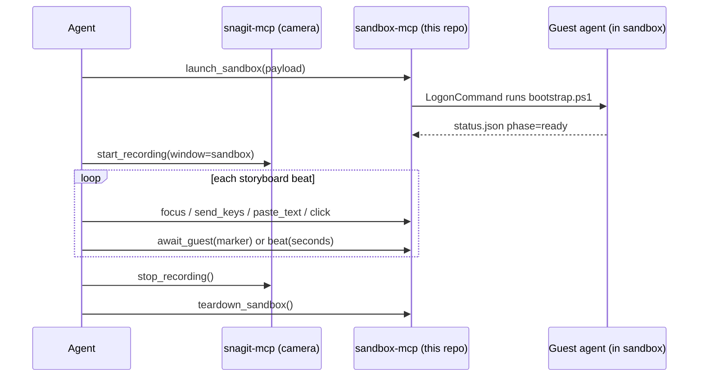

# Plan: WindowsSandboxMCPServer

Target repo: `paullizer/WindowsSandboxMCPServer`
Companion repo: `paullizer/LocalSnagitMCPServer` (already working — mirror its conventions)

---

## 1. Mission

A local MCP server that stands up a **Windows Sandbox**, drives it with synthetic keyboard/mouse
input, and runs a repo's install-and-deploy flow **from a pristine machine** — while Snagit records
the screen, producing a narrated demo video.

The story we want on camera:

> clean Windows → open browser → download prereqs → install them → open a terminal →
> `az login` / `azd auth login` → clone repo → run deploy scripts → working app

Two MCP servers cooperate. This repo is the **driver**; the existing Snagit server is the **camera**.



---

## 2. Design decision: no screenshots, but not blind

**Agreed:** no vision model in the loop, no screenshot tool returned to the agent, no image files on
disk. Snagit owns the pixels. A vision agent would be slow, non-deterministic, and would visibly
flail on camera.

**But** something has to answer *"is the installer finished yet?"* If the only answer is
`Start-Sleep 45`, the whole thing is a house of cards.

The replacement for screenshots is a **guest status channel over a mapped folder** — and it is
strictly better than screenshots for this purpose:

| Question | Answered by |
|---|---|
| Did the install finish? | Guest writes `status.json` marker — it *knows*, no guessing |
| Did the script fail? | Guest writes exit code + stderr tail |
| Is the terminal ready? | Guest marker |
| How long do I hold this shot? | `beat(seconds)` — pure pacing, not synchronization |

Text-based, deterministic, millisecond-cheap, and it survives window resizes and theme changes.

**Escape hatch (Phase 6, build only if needed):** a few moments are GUI-only and the guest can't
self-report — third-party installer wizards, browser download bars. For those, add an *internal*
pixel gate: OpenCV `matchTemplate` against a small reference crop, in-process, never returned to the
agent, never written to disk. That is not "using screenshots" in the sense you meant; it is a
`WaitForImage` primitive. Do not build it until a real storyboard needs it.

---

## 3. Strategy: keyboard-first

Nearly everything in the target story is keyboard-driven. Lean into this hard — it is both more
reliable *and* better-looking on video than mouse hunting.

| Goal | Keys |
|---|---|
| Open browser | `Win` → `edge` → `Enter` |
| Navigate | `Ctrl+L` → paste URL → `Enter` |
| Downloads panel | `Ctrl+J` → `Enter` to run installer |
| Terminal | `Win+R` → `powershell` → `Enter` |
| Every command | paste + `Enter` |

**Clipboard redirection is enabled by default in Windows Sandbox.** Set the host clipboard, send
`Ctrl+V`. No per-character typing races, no typos in long `azd` commands and URLs.

Keep `type_text` as a *separate, deliberate* tool for short strings you want visibly typed on camera
for narrative effect. Use `paste_text` for everything long or exact.

Reserve `click` for genuine GUI moments only.

---

## 4. Repo layout

Mirror the Snagit server's shape (src layout, setuptools, `__main__` with `--selftest`).

```
pyproject.toml
README.md
payload/
  bootstrap.ps1            # LogonCommand entry point, runs in guest
  lib/
    agent.ps1              # command pump + status writer
    install-helpers.ps1    # scoop/direct-download helpers
storyboards/
  example-azd-deploy.yaml
src/sandbox_mcp/
  __init__.py
  __main__.py              # `python -m sandbox_mcp [--selftest]`
  config.py                # Settings.from_env()
  server.py                # MCP tool surface + INSTRUCTIONS
  sandbox.py               # .wsb generation, launch, window discovery, teardown
  wininput.py              # SendInput keyboard/mouse, clipboard
  windows.py               # ctypes Win32 helpers (adapt from snagit repo)
  guest.py                 # status/heartbeat/command-pump protocol
  storyboard.py            # Phase 4 — declarative beat runner
tests/
  smoke_input.py
  smoke_sandbox.py
```

`pyproject.toml` — copy the Snagit one, change names:

```toml
[project]
name = "windows-sandbox-mcp"
version = "0.1.0"
description = "Local MCP server that drives Windows Sandbox for recorded deployment demos"
requires-python = ">=3.10"
dependencies = ["mcp>=2.0.0,<3", "pyyaml>=6.0", "pywin32>=306; sys_platform == 'win32'"]

[project.scripts]
windows-sandbox-mcp = "sandbox_mcp.__main__:main"
```

---

## 5. Tool surface

### Lifecycle
```
check_sandbox_setup()      -> feature enabled, Windows edition, virtualization, wsb CLI present
launch_sandbox(payload_dir, networking=True, memory_mb=8192, vgpu=True, window=(1600,900))
                           -> session_id
await_desktop(timeout=120) -> blocks until guest bootstrap reports phase=ready
teardown_sandbox()
sandbox_info()             -> window rect, client origin, guest resolution, scale, phase
```

### Input  (all require the sandbox window to be foreground)
```
focus_sandbox()                       -> bool; call before any input; verify GetForegroundWindow
send_keys("ctrl+l")                   -> chord syntax: ctrl/alt/shift/win + key, or bare key name
type_text(text, cps=14)               -> visibly typed, human-paced, for camera
paste_text(text)                      -> clipboard + ctrl+v; use for anything long or exact
click(x, y, button="left", double=False)
move_mouse(x, y, duration_ms=250)     -> smooth visible cursor travel; instant jumps look wrong
scroll(dy)
```

### Sync / pacing
```
beat(seconds, reason="")              -> pacing only, mirrors snagit `wait`
await_guest(marker, timeout=300)      -> poll status.json for a marker written by the guest
guest_status()                        -> current phase, last marker, last exit code
read_guest_log(tail=80)               -> tail of the guest transcript
```

### Guest execution
```
run_in_guest(command, visible=True, await_exit=True) -> exit_code, output
```
- `visible=True` — paste into the on-screen terminal and press Enter. **On camera.** For story beats.
- `visible=False` — drop a `.cmd` file in the control inbox; the guest agent executes it silently.
  **Off camera.** For setup, fixtures, and anything you don't want in the video.

That `visible` flag is the key ergonomic idea: boring setup runs fast and invisibly, story beats
happen deliberately and on screen.

---

## 6. Guest agent protocol

Host writes a payload folder; it is mapped **read-only** into the guest. A second, empty folder is
mapped **read-write** as the control/return channel.

```
host payload/  -> C:\payload   (ReadOnly=true)
host control/  -> C:\ctl       (ReadOnly=false)
    ctl/status.json      guest -> host   {phase, marker, ts, last_exit_code}
    ctl/transcript.log   guest -> host   append-only console transcript
    ctl/inbox/*.cmd      host  -> guest   commands for visible=False execution
    ctl/outbox/*.json    guest -> host   {id, exit_code, stdout_tail, stderr_tail}
```

`bootstrap.ps1` (runs via `<LogonCommand>`):
1. Write `status.json` phase=`booting`
2. Set up console: font size up, window maximized — small default fonts look terrible on video
3. Start background command-pump watching `C:\ctl\inbox`
4. Write phase=`ready`, marker=`desktop_ready`
5. Idle forever

This gives you host→guest execution **without** depending on the `wsb exec` CLI (which may or may
not exist on your build). Check with `Get-Command wsb` in `check_sandbox_setup` and prefer it when
present, but never require it.

Storyboards call `mark <name>` from inside guest scripts to publish sync points:
```powershell
function mark($name) { ... write status.json marker=$name ... }
mark "prereqs_installed"
```
Host then does `await_guest("prereqs_installed")`. No timing guesswork.

---

## 7. Win32 technical specs

These are the details that will cost you a day each if you get them wrong.

**DPI awareness.** Call `SetProcessDpiAwarenessContext(-4)` (per-monitor-v2) at startup, before any
window query. Copy `ensure_dpi_awareness()` from the Snagit repo's `windows.py` verbatim. Without
it, `GetWindowRect` and injected mouse coordinates disagree on scaled displays.

**Window discovery.** Find the sandbox by process name `WindowsSandboxClient.exe`, take its top-level
window. *Verify the class name empirically on your machine and pin it once confirmed* — do not trust
a hardcoded guess.

**Coordinate mapping.** Tools take **guest-relative** coordinates. Convert:
```
host_screen_pt = client_origin + guest_pt * scale
```
Get `client_origin` from `ClientToScreen(hwnd, POINT(0,0))`. Use `GetClientRect` for the render area,
not `GetWindowRect` (which includes chrome). Pin the window size at launch so `scale` stays 1.0 and
recorded storyboards stay valid across runs.

**Keyboard injection.** Use `SendInput` with `KEYEVENTF_SCANCODE` and scancodes, **not** virtual-key
codes. VK-based injection is measurably less reliable through RDP. Set `KEYEVENTF_EXTENDEDKEY` for
arrows, nav cluster, right-alt/ctrl, and numpad-enter. Add a small inter-key delay (~15-30ms);
zero-delay bursts get dropped by the RDP channel.

**Mouse injection.** `SendInput` with `MOUSEEVENTF_ABSOLUTE | MOUSEEVENTF_VIRTUALDESK`, coordinates
normalized to 0..65535 across the **virtual** desktop (use `SM_XVIRTUALSCREEN` / `SM_CXVIRTUALSCREEN`
— already present in the Snagit `windows.py`).

**Clipboard.** `OpenClipboard` / `EmptyClipboard` / `SetClipboardData(CF_UNICODETEXT)`. Retry on
failure — the clipboard is a shared lock and other apps grab it. **Save and restore the host
clipboard** around every paste; silently eating the user's clipboard is hostile.

**Focus verification.** After `focus_sandbox()`, confirm with `GetForegroundWindow()`. If it doesn't
match, fail loudly rather than injecting keystrokes into the host. This is the single most important
safety check in the server — misdirected input on the host is both a broken take and a real hazard.

---

## 8. `.wsb` configuration reference

Verified against Microsoft Learn:

```xml
<Configuration>
  <MemoryInMB>8192</MemoryInMB>
  <vGPU>Enable</vGPU>
  <Networking>Enable</Networking>
  <ClipboardRedirection>Enable</ClipboardRedirection>
  <MappedFolders>
    <MappedFolder>
      <HostFolder>E:\sandboxlab\payload</HostFolder>
      <SandboxFolder>C:\payload</SandboxFolder>
      <ReadOnly>true</ReadOnly>
    </MappedFolder>
    <MappedFolder>
      <HostFolder>E:\sandboxlab\control</HostFolder>
      <SandboxFolder>C:\ctl</SandboxFolder>
      <ReadOnly>false</ReadOnly>
    </MappedFolder>
  </MappedFolders>
  <LogonCommand>
    <Command>powershell -ExecutionPolicy Bypass -NoProfile -File C:\payload\bootstrap.ps1</Command>
  </LogonCommand>
</Configuration>
```

Notes:
- Mapped folders attach **before** `LogonCommand` runs — ordering is guaranteed.
- `LogonCommand` accepts exactly **one** command; everything real goes in the script.
- Launch with `WindowsSandbox.exe <config>.wsb`.
- Element is `<vGPU>`, lowercase v.

---

## 9. Storyboard format (Phase 4)

Declarative beats, so takes are repeatable and pacing is tunable without touching code.

```yaml
name: azd-deploy-from-clean-windows
steps:
  - await_guest: desktop_ready
  - beat: { seconds: 2.0, reason: "let the clean desktop land" }

  - send_keys: win
  - beat: 0.8
  - type_text: { text: "edge", cps: 12 }
  - send_keys: enter
  - beat: 2.5

  - send_keys: ctrl+l
  - paste_text: "https://aka.ms/azd-install"
  - send_keys: enter
  - beat: 3.0

  - run_in_guest: { command: "C:\\payload\\install-prereqs.ps1", visible: true }
  - await_guest: prereqs_installed
  - beat: 1.5

  - run_in_guest: { command: "az login --use-device-code", visible: true }
  - await_guest: azure_authenticated
```

Every step gets an implicit trailing beat (default ~0.6s) so nothing snaps instantly. Instant
automation is unwatchable — this is the same lesson already encoded in the Snagit server's
instructions.

---

## 10. Build phases

Each phase ends with a runnable acceptance check. Do not start the next phase until it passes.

| # | Phase | Deliverable | Acceptance |
|---|---|---|---|
| 0 | Scaffold | Repo, pyproject, `__main__ --selftest`, `check_sandbox_setup` | `python -m sandbox_mcp --selftest` reports edition, feature state, virtualization |
| 1 | Lifecycle | `.wsb` generation, launch, window discovery, `focus_sandbox`, teardown | Sandbox launches, window found, focus verified via `GetForegroundWindow` |
| 2 | Input | `send_keys`, `type_text`, `paste_text`, `click`, `move_mouse` | Open Notepad in guest by keyboard only; type + paste text correctly |
| 3 | Guest channel | `bootstrap.ps1`, status protocol, command pump, `run_in_guest`, `await_guest` | `run_in_guest(visible=False)` returns a real exit code; `await_guest` unblocks on a marker |
| 4 | Storyboard | YAML runner with implicit beats | Example storyboard replays end-to-end unattended |
| 5 | Compose | Snagit + sandbox together | First recorded video: clean Windows → prereqs → `az login` → deploy |
| 6 | Pixel gates *(only if needed)* | Internal `matchTemplate` wait | Installer wizard gated without a fixed sleep |

---

## 11. Gotchas

**Focus stealing is enemy #1.** It breaks input *and* ruins the take. Injected keys go to whatever is
foreground — a host toast or VS Code notification both misdirects keystrokes into the host and
appears on camera. Enable Do Not Disturb before recording. Never run host terminal commands mid-take.
Re-verify foreground before every input batch.

**One sandbox at a time.** Microsoft's docs are explicit: no simultaneous instances. No parallel takes.

**Pro / Enterprise / Education only.** No Home. Needs hardware virtualization; nested virt if the
host is itself a VM.

**No `winget` preinstalled**, and no Microsoft Store. Use Scoop or direct downloads. (Installing App
Installer first is possible but slow and visually boring.)

**Fully ephemeral.** Every run redownloads everything unless you cache into a mapped folder. Consider
a read-only `cache/` mapping for large installers to keep takes short.

**Reboots survive** on Windows 11 22H2+ for restarts initiated *inside* the sandbox — useful, since
some installers demand one.

**No Hyper-V or Docker inside** the sandbox.

**Cold start is slow.** Budget for boot + bootstrap in `await_desktop`; default timeout 120s.

---

## 12. Security

**Never `type_text` a secret.** It renders on screen and Snagit is recording. For Azure auth use
`az login --use-device-code` (also narrates better on video), or a service principal whose secret is
read by a guest script from the payload folder and never displayed. Add a guard in `type_text` and
`paste_text` that refuses obvious credential patterns unless explicitly overridden.

**The read-write mapped folder is a genuine host-write path.** Guest code can write anything there
and it persists after disposal. Keep it narrow, empty at start, and separate from the read-only
payload. Never map a broad host directory read-write.

**`<Networking>Enable</Networking>` exposes the guest to your internal LAN**, not just the internet.
For untrusted repos, pre-stage dependencies in the read-only folder and disable networking.

**The sandbox is the security boundary** for running unvetted install scripts — that is the point,
and it is a genuine benefit of this design over running the same scripts on the host.

---

## 13. Conventions to mirror from LocalSnagitMCPServer

- `src/` layout, setuptools, `[project.scripts]` console entry point
- `__main__.py` with a `--selftest` branch that prints the setup-check tool's JSON
- Module-level `server = MCPServer(name=..., title=..., version=..., instructions=INSTRUCTIONS)`
- `@server.tool()` async functions returning plain `dict[str, Any]`
- `Settings.from_env()` in `config.py`
- Lazy singleton accessor (`get_recorder()` → here, `get_driver()`) so import stays cheap
- A rich `INSTRUCTIONS` string stating the operating rules — that is what makes the Snagit server
  behave well, and it matters more here. Must state: focus is required, the sandbox must stay
  foreground, prefer `paste_text` over `type_text`, prefer `await_guest` over `beat` for
  synchronization, and never type secrets.

---

## 14. First prompt for the new window

> Read PLAN.md. Implement Phase 0 and Phase 1 only. Mirror the packaging and server conventions from
> the LocalSnagitMCPServer repo described in section 13. Stop after the Phase 1 acceptance check
> passes and show me the result of `python -m sandbox_mcp --selftest`.
